

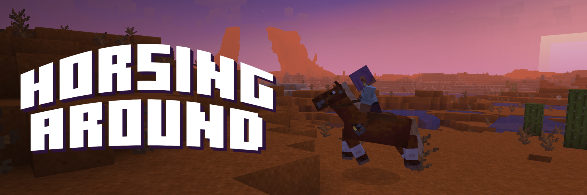

**Horses in Minecraft finally ride like real animals.** Horsing Around replaces vanilla horse riding: your horse walks,
trots, canters and gallops, carries real momentum, tires out, and refuses to run you off a cliff. It's still the vanilla
horse, ridden with the keys you already know.

I've always loved the horses in Red Dead Redemption 2, and riding in Minecraft never felt anything like them. This mod
is my go at changing that.

### Gaits

Speed builds up and fades out through each gait instead of switching on and off, and a well-bred horse still outruns the
rest.

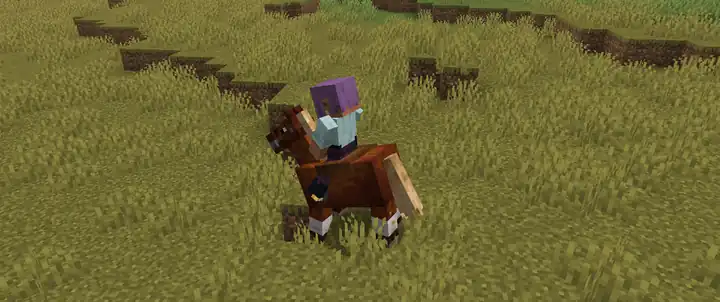

### Turning

The horse goes where you look: wide at a gallop, on the spot at a walk, and a hard cut if you look sharply to one side.

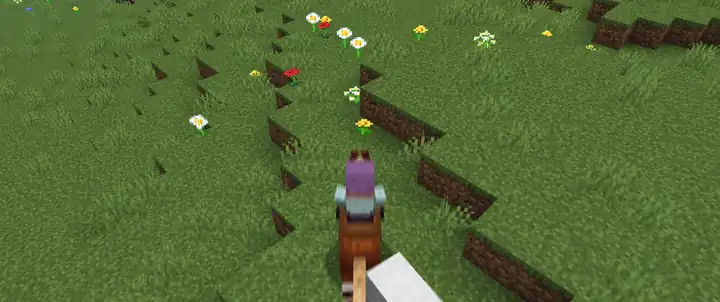

### Stamina

Galloping drains a bar where the jump bar used to be. Run it out and the horse drops to a canter until it gets its wind
back.

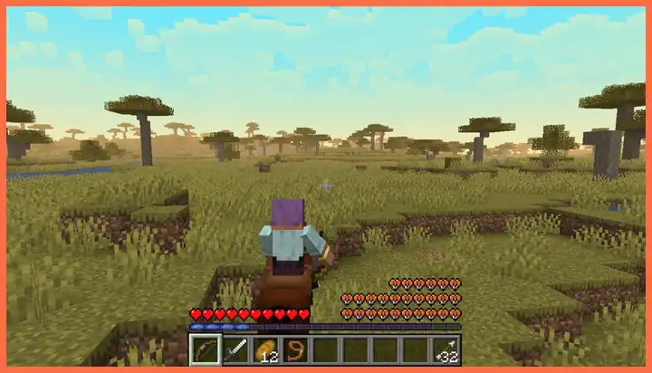

### Jumping

Press jump and it jumps, with no bar to charge, keeping its speed through the air.

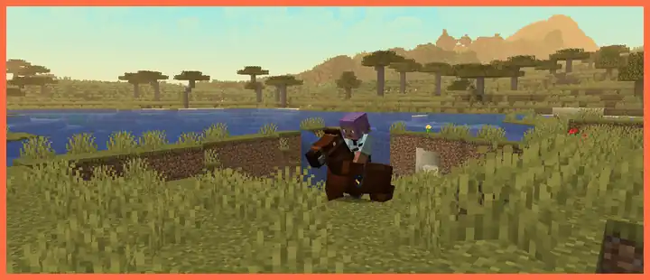

### Footing

From a trot it steers round trees and rocks, slows for walls and climbs ledges up to two blocks high. It won't take a
drop that would hurt it or walk into lava. Fences you'll have to jump.

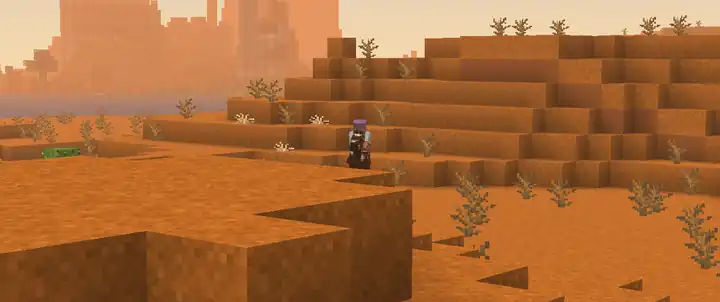

### Water and trees

Horses swim with their heads up and climb out on the far bank. Leaves slow you instead of stopping you dead. At speed
you'll trample small animals, but never players or your own pets.

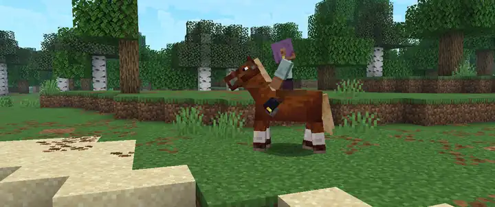

### The rider

Horse and rider lean into turns. The rider keeps their feet in the stirrups and hands on the reins, folds over jumps and
draws a bow like an archer. The hoofbeats change with the gait.

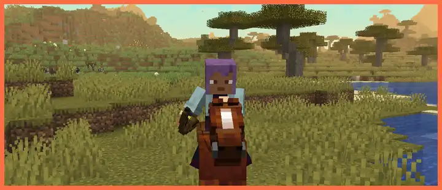

### Camera

Getting on switches to an over-the-shoulder view with a crosshair: arrows, swings and anything you throw go where it
points. The camera pulls back as you speed up and leans in for a bow or spyglass. Press O to swap shoulders.

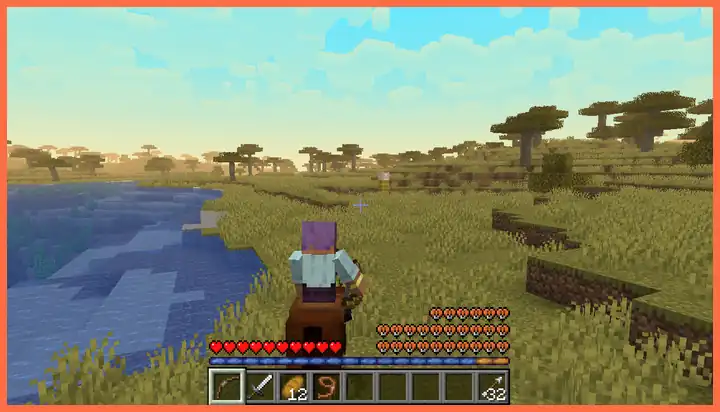

## Controls

| Key | On horseback |
| --- | --- |
| W | Walk on. Let go and the horse slows to a stop. |
| Sprint | Tap for the next gait up. |
| W, twice | Next gait up, and the horse keeps going with W let go until you press S. |
| S | Tap for the next gait down. Hold to stop hard, then back up. |
| Mouse | Steer. Standing still, you can look around and the horse stays put. |
| A / D | With W, ride at an angle to where you're looking. Alone, ride straight across it. |
| Jump | Jump, straight away. |
| O | Swap the camera to your other shoulder. |

## Which mounts

Horses, donkeys, mules, skeleton horses and zombie horses. Everything else you can ride stays vanilla. Making a horse
mod? Add your horse to the entity type tag `horsingaround:managed` and it rides this way too.

## Servers

Install it (and Fabric API, on Fabric) on the server and in each player's game. Players without it can still join and
ride as normal. On a server without it, your horse rides like vanilla and the mod tells you so.

## Settings

Horses ride the same for everyone. You can change the camera, how much the view moves and how loud the horse is, and if
motion bothers you, all of it turns down. Open the settings from [Mod Menu](https://modrinth.com/mod/modmenu) (on
NeoForge and Forge, the Mods screen) or with the "Open horse settings" key.

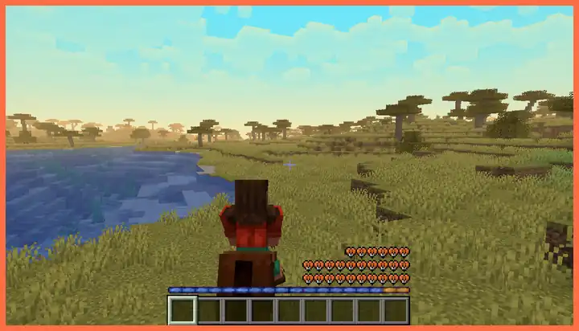

## Other mods

Tested first against [Fresh Animations](https://modrinth.com/resourcepack/fresh-animations) (Entity Model Features +
Entity Texture Features), and the rider follows the animated horse. If another mod also changes how horses ride or
riders sit, Horsing Around handles its own horses and leaves the rest of that mod alone. Shoulder Surfing takes over the
camera whenever it's on.

With [Icy's Better Horses](https://modrinth.com/mod/icys-better-horses), pick whose riding horses use under **Riding** on
the settings' Compatibility tab (on a server, the server picks). Pick Horsing Around's and Icy's breeds ride this way, with all of Icy's
features still working. Pick Icy's and Horsing Around leaves horses alone.

With [Realistic Horse Genetics](https://www.curseforge.com/minecraft/mc-mods/realistic-horse-genetics) (Forge, Minecraft
1.20.1), its horses, donkeys and mules ride this way too, keeping their own look, and their hooves find the ground at
whatever size their genes give them.

<b>Every mod it's tested with</b>

Automated test rides run alongside Sodium, Iris, Lithium, C2ME, FerriteCore, ImmediatelyFast, Entity Culling, More
Culling, Not Enough Animations, Emotecraft, Better Combat, First-person Model, Real Camera, Shoulder Surfing Reloaded,
Camera Overhaul, Freecam, Do a Barrel Roll, AppleSkin, Raised, Better Mount HUD, Jade, Xaero's Minimap, Horse Expert, Horseman,
Bareback Horse Riding, Mounts Stay Still, Icy's Better Horses and Realistic Horse Genetics.

Something not getting along? [Open an issue](https://github.com/GabePurc/horsing-around/issues/new?template=bug_report.yml).

## Requirements

- **Fabric:** Minecraft 1.20.1 to 26.3, Fabric Loader 0.14.25 or newer (or whatever your Fabric API needs) and Fabric API. Mod Menu is optional.
- **NeoForge:** Minecraft 1.21.1, 26.1.2, 26.2 or 26.3, with NeoForge for that version.
- **Forge:** Minecraft 1.20.1, 1.20.2, 1.20.4, 1.20.6, 1.21.1, 1.21.3, 1.21.4, 1.21.5, 1.21.8, 1.21.10, 1.21.11, 26.1.2, 26.2 or 26.3, with Forge for that version.

## Buy me a coffee, get a hat

The mod is free and will stay that way. [Buy me a coffee](https://buymeacoffee.com/blintzbug), then
[claim your hat](https://horsing-around-hats.blintzbug.workers.dev) with your Minecraft username, and within about 10
minutes you'll find a cowboy hat in your horse settings, in any colour you like. Everyone on your server who has the mod
sees it. It's only cosmetic: your helmet is hidden under it but still protects you.

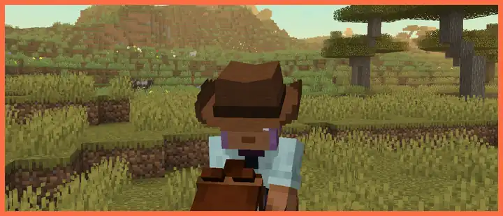

## Privacy

At startup, and now and then while you play, the mod downloads the supporter list (`supporters.json` in this repository)
from GitHub to know who gets a hat. Nothing about you is sent. If it can't connect, it uses the last list it saw.

If you claim a hat, your Minecraft username goes on that public list. Your email is only compared against a scrambled copy
of the one on your payment, and is never stored in readable form.

## What's next

Horse perks and levelling, so the horse that's carried you across the map is better than one you tamed yesterday.

## License

[LGPL-3.0-only](https://github.com/GabePurc/horsing-around/blob/main/COPYING.LESSER), which adds its permissions to the [GPL-3.0](https://github.com/GabePurc/horsing-around/blob/main/COPYING). Releases up to 0.5.2 are MIT.

## How it's made

The code is written by AI, but every decision is made by me, a person partway through a computer science degree. I
decide what the mod does, how each part of it should feel, and when it's good enough to release. This is not just a one
shot prompt AI slop project, I am putting effort into making it as good as it can be, and AI is a great tool for doing
exactly that.
